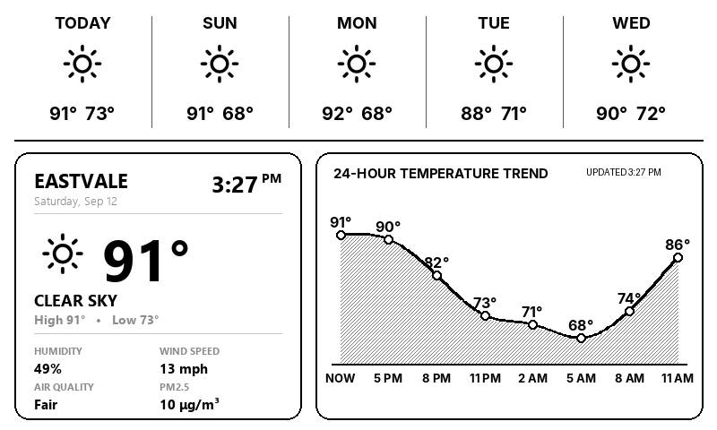
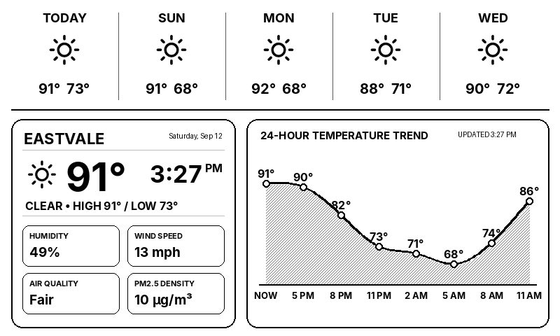
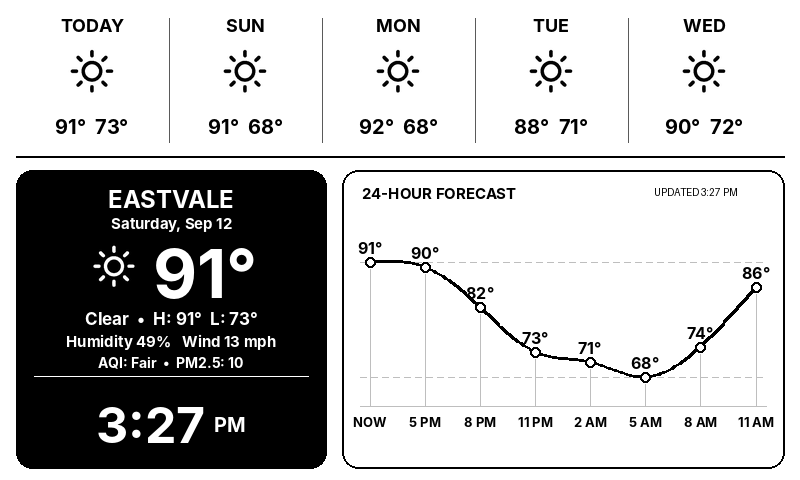

# DriftWeather / G4Cast E-Ink Weather Station 🌦️

A high-performance, elegant Python dashboard and e-paper meteorological station designed for the **Waveshare 7.5-inch V2 E-Paper Display (800×480)** powered by a **Raspberry Pi Zero 2 W**.

Includes **4 visual themes**, custom cubic spline temperature curves, stipple dithering, Dark Mode with solar auto-switching, live National Weather Service (NWS) severe weather advisory alerts, an integrated Web Control Panel, and production-ready 3D printable enclosures.

---

## 🎨 Theme Gallery

G4Cast includes **4 distinct visual themes** engineered specifically for 1-bit monochrome e-ink displays, featuring custom cubic spline interpolation, stipple dithering, high-contrast typography, and live NWS alerts:

### Option 3: Minimalist Scandinavian / Braun (Active Default)
> *Open-air borderless layout, architectural 62pt clock anchor, generous whitespace, dithered spline curve, and elegant hairline rules.*



---

### Option 1: Modern Widget Tiles
> *Structured 2×2 metric cards (Humidity, Wind Speed, Air Quality, UV/Baro), integrated top-right clock, and smooth shaded temperature trend.*



---

### Option 2: Dual-Tone Inverted Hero
> *High-contrast solid black hero card with pure white typography and glyphs, 50pt night clock, and crisp white graph card.*



---

### Option 4: 3D Product & Industrial Edition
> *Dense telemetry view optimized for desk mounting alongside 3D printers and workstation peripherals.*

---

## 🚀 Switching Themes

You can effortlessly switch themes at any time on your Raspberry Pi using the built-in theme switcher tool or via the Web Control Panel:

```bash
# List available themes
python3 switch_theme.py list

# Switch to Option 3: Minimalist Scandinavian (Default)
python3 switch_theme.py 3

# Switch to Option 1: Modern Widget Tiles
python3 switch_theme.py 1

# Switch to Option 2: Dual-Tone Inverted Hero
python3 switch_theme.py 2

# Switch to Option 4: Industrial 3D Product
python3 switch_theme.py 4
```

The script automatically:
1. Replaces the active `/home/user/G4Cast/G4Cast.py`.
2. Persists the file to the underlying physical microSD card partition (`/media/root-ro`) under OverlayFS.
3. Triggers `sudo systemctl restart G4Cast.service` to immediately refresh your e-ink screen.

---

## 🌐 Web Control Panel (Port 8080)

Connect any phone, tablet, or browser on your local network to:
`http://<pi-ip>:8080`

### Features:
- **Live Display Preview Mirror**: View the exact 800×480 screen buffer rendered in real time.
- **One-Click Refresh & Waveform Clean**: Deep waveform refresh cycles to eliminate e-paper ghosting.
- **Visual Mode**: Toggle between `Off (Always Light)`, `On (Always Dark)`, or `Auto (Solar: Sunset -> Sunrise)`.
- **Location Search**: Search cities worldwide and update coordinates dynamically.
- **Severe Weather Simulation**: Preview simulated NWS Flood, Wind, or Blizzard alerts directly on the mirror.
- **Configuration Backup & Restore**: One-click download of `settings.json` or upload to restore.

---

## 🌟 Key Engineering Highlights

- **Dynamic Auto-Scaling**: Accommodates 3-digit temperatures (100°F+) without clipping or layout breaking.
- **Dithered Cubic Spline Graph**: Continuous 24-hour temperature curve with subtle Bayer/stipple area fill.
- **National Weather Service (NWS) Alerts**: Real-time integration with `api.weather.gov` for active advisories (Excessive Heat Warnings, High Wind Watches, Flood Advisories) with cached offline fallback.
- **Air Quality (AQI) & PM2.5**: Real-time EPA AQI indexing and PM2.5 particle density.
- **Partial Refresh Minute Clock**: Sub-second partial e-paper updates every minute with anti-ghosting full refresh cycles every 15 minutes.
- **Self-Healing Wi-Fi Watchdog**: Auto-reconnects to Wi-Fi with gateway ping fallbacks and fallback access point mode.
- **OverlayFS Safe**: Designed for read-only root filesystems to eliminate SD card corruption from sudden power loss.

---

## 🛠️ Hardware Requirements & 3D Enclosure

- **Display**: Waveshare 7.5" V2 Black/White E-Paper (800×480, SPI)
- **SBC**: Raspberry Pi Zero 2 W (or Pi 3/4/5)
- **3D Printed Enclosure**: Located in `hardware/G4Cast.3mf` (6.5 MB multi-part printable desk frame).
- **Setup Manual**: Complete installation guide in `hardware/G4Cast_SoftwareInstall.pdf`.
- **OS**: Raspberry Pi OS (Debian 12 Bookworm / 64-bit) with OverlayFS enabled.

---

## 📂 Repository Structure

```text
DriftWeather/
├── G4Cast.py                 # Active display controller entrypoint
├── main.py                   # Master unified runner (display + scheduler + web)
├── modern_renderer.py        # 800x480 high-contrast 1-bit monochrome rendering engine
├── switch_theme.py           # CLI theme switcher utility
├── ClearScreen.py            # E-paper deep clean utility
├── ConnectWifi.py            # Wi-Fi auto-connector & hotspot recovery
├── CreateService.py          # Systemd unit installation
├── display/                  # E-Paper hardware drivers & rendering pipeline
│   ├── epd7in5_V2.py         # Waveshare 7.5" V2 SPI driver
│   ├── epaper.py             # Hardware abstraction with virtual PC mirror fallback
│   └── renderer.py           # Core coordinate & text renderer
├── weather/                  # Weather data acquisition & caching
│   ├── providers.py          # OpenWeather (Current, Forecast, AQI), NOAA KCNO, NWS Alerts
│   ├── updater.py            # Async polling & event dispatching
│   └── cache.py              # Multi-tier caching with subtle freshness formatting
├── services/                 # Background system daemons
│   ├── health.py             # System metrics (CPU temp, RAM, Disk, RSSI, Uptime)
│   ├── scheduler.py          # Master scheduler: 30m weather sync, 1m clock, quiet hours
│   └── wifi_watchdog.py      # Self-healing Wi-Fi monitor
├── web/                      # Flask Web Control Panel (Port 8080)
│   ├── server.py             # REST API & WebSocket server
│   ├── templates/index.html  # Modern responsive dashboard
│   └── static/               # CSS & theme preview assets
├── themes/                   # Theme implementations
│   ├── option1_widget/       # Modern Widget Tiles
│   ├── option2_dualtone/     # Dual-Tone Inverted Hero
│   ├── option3_minimalist/   # Minimalist Scandinavian (Default)
│   └── option4_3d_product/   # Industrial 3D Product edition
├── hardware/                 # Physical build files & CAD
│   ├── G4Cast.3mf            # Complete 3D printable desktop enclosure
│   └── G4Cast_SoftwareInstall.pdf # Software installation and flashing manual
├── docs/                     # Guides and previews
│   ├── OPERATIONS.md         # Full operations, troubleshooting & runbook
│   └── previews/             # High-resolution theme screenshots
├── tests/                    # 72 comprehensive automated unit & adversarial tests
├── fonts/                    # High-legibility Inter & typography files
├── pic/                      # Weather icons & bitmap glyphs
├── requirements.txt          # Python dependencies
├── LICENSE                   # MIT License
└── README.md
```

---

## 🧪 Running Tests

```bash
# Run all 72 automated unit, solar, and adversarial tests:
python -m unittest discover -s tests -v
```

---

## 📄 License & Credits

Distributed under the MIT License. See [`LICENSE`](LICENSE) for details.

* **Author**: Devyn Fidel ([@The-Osprey1](https://github.com/The-Osprey1))
* **Co-Authors & Contributors**: Claude, Codex
* **Display Driver**: Waveshare Electronics
