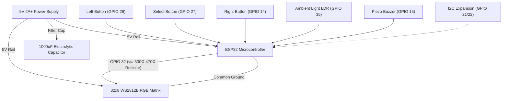

# Hardware & Electrical Schematics

This document provides complete electrical schematics, Bill of Materials (BOM), pinout mapping, and 3D printing enclosure guides for building the physical 32×8 RGB LED Matrix Weather Station.

---

## 🔌 Bill of Materials (BOM)

| Category | Component | Specification | Quantity | Notes |
| :--- | :--- | :--- | :---: | :--- |
| **Microcontroller** | ESP32 Development Board | ESP32-WROOM-32 / ESP32-D0WD / ESP32-S3 (4MB+ Flash) | 1 | Ulanzi TC001 or standalone dev board |
| **Display** | 32×8 Flexible RGB LED Matrix | WS2812B / Neopixel (256 addressable LEDs, 5V) | 1 | Serpentine or parallel rows |
| **Power Supply** | 5V DC Power Adapter | 5V / 2.0A – 3.0A DC (USB-C or barrel jack) | 1 | 256 LEDs at full white can draw up to 3.5A; typical ambient draws 0.3A–0.8A |
| **Capacitor** | Electrolytic Capacitor | 1000 µF, 6.3V or higher | 1 | Placed across 5V and GND power rails at display input |
| **Resistor** | Carbon Film / Metal Film | 330Ω to 470Ω (1/4W) | 1 | Series resistor on matrix DIN line for signal reflection protection |
| **Light Sensor** | LDR Photoresistor (optional) | GL5528 + 10kΩ resistor | 1 | Ambient light auto-dimming divider |
| **Inputs** | Tactile Push Buttons (optional) | 6×6mm momentary switches | 3 | Left, Select/OK, Right navigation |
| **Sounder** | Piezo Buzzer (optional) | 5V passive/active buzzer | 1 | GPIO 15 alert notifications |
| **Housing** | 3D Printed Enclosure | `AWTRIX3-M-1.3mf` (Enclosure) + `Clock Stand.3mf` | 1 | Printed in PLA/PETG with light diffuser plate |

---

## 📌 Microcontroller Pinout Mapping

| Function | Pin (ESP32) | Mode | Signal Type | Electrical Notes |
| :--- | :---: | :---: | :---: | :--- |
| **LED Matrix DIN** | **GPIO 32** | Output | High-Speed Digital | Series 330Ω–470Ω resistor recommended |
| **Power (+5V)** | **5V / VIN** | Power | 5V DC Rail | Connect directly to external 5V supply |
| **Ground (GND)** | **GND** | Ground | Common Ground | Tie ESP32 GND and Matrix GND together |
| **Left Button** | **GPIO 26** | Input | Digital Input | Active LOW (Internal pull-up enabled) |
| **Select Button** | **GPIO 27** | Input | Digital Input | Active LOW (Internal pull-up enabled) |
| **Right Button** | **GPIO 14** | Input | Digital Input | Active LOW (Internal pull-up enabled) |
| **Light Sensor (LDR)**| **GPIO 35** | Analog | ADC1 (0–3.3V) | Voltage divider with 10kΩ resistor to GND |
| **Battery Voltage** | **GPIO 34** | Analog | ADC1 | 200kΩ / 100kΩ voltage divider |
| **Piezo Buzzer** | **GPIO 15** | Output | PWM / Tone | Piezo sounder for weather hazard chimes |
| **I2C SDA (Sensors)** | **GPIO 21** | I/O | Open-Drain | Optional BME280 / SHT31 sensor bus |
| **I2C SCL (Sensors)** | **GPIO 22** | Output | Open-Drain | Optional BME280 / SHT31 sensor bus |

---

## ⚡ Circuit Schematic

```
                      +---------------------------------------+
                      |       5V Power Supply (>= 2A)         |
                      +-------------------+-------------------+
                                          |
                         +----------------+----------------+
                         |                                 |
                        5V                                5V
                         |                                 |
                 +-------v-------+                 +-------v-------+
                 |  ESP32 Board  |                 |  32x8 WS2812B |
                 |               |                 |  LED Matrix   |
                 |       GPIO 32 +---[ 330Ω-470Ω ]-+-> DIN         |
                 |               |                 |               |
                 |           GND +--------+--------+-> GND         |
                 |               |        |        +---------------+
                 |       GPIO 26 +--[Btn]-+ (Left)         |
                 |       GPIO 27 +--[Btn]-+ (Select)  [ 1000 µF ]
                 |       GPIO 14 +--[Btn]-+ (Right)   (across 5V & GND)
                 |               |        |
                 |       GPIO 35 +--[LDR]-+--> 3.3V (with 10k pull-down)
                 |       GPIO 15 +--[Buzzer]-+
                 +---------------+
```



---

## 🖨️ 3D Printing & Enclosure

The `hardware/` folder includes production-ready CAD files for enclosing and displaying the station:

1. **`AWTRIX3-M-1.3mf`**:
   - Complete desktop housing tailored for 32×8 LED matrices and ESP32 boards.
   - Integrated mounting lugs, USB-C port cutout, and light diffuser frame.
   - Recommended print settings: 0.20mm layer height, 3 walls, 15% gyroid infill, PETG or PLA.
2. **`Clock Stand.3mf` & `Clock Stand.step`**:
   - Sturdy, ergonomic angled desk stand for optimal viewing angle on desks and nightstands.
   - Includes STEP format for direct CAD modification in Fusion 360, SolidWorks, or FreeCAD.
